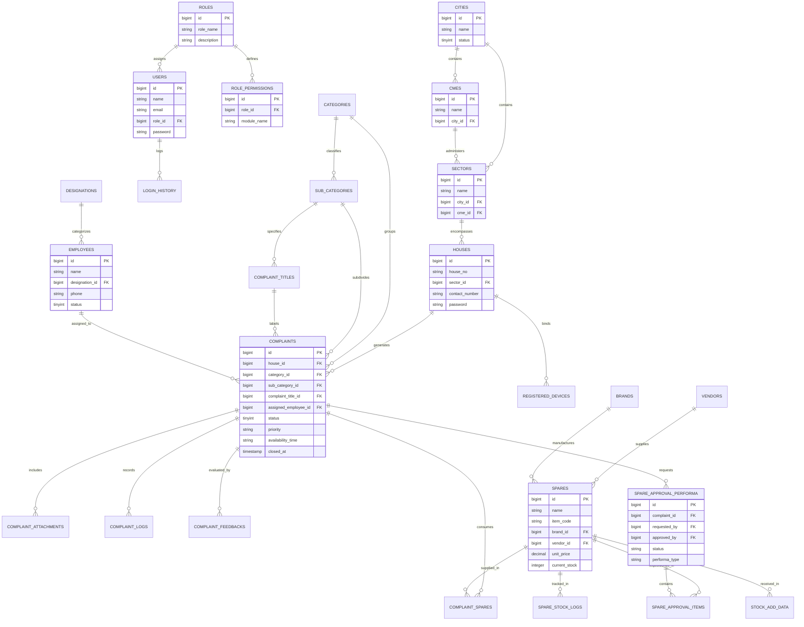

# Pakistan Navy Complaint Management System (CMS)
# Document 05: Database ERD & Data Dictionary

**Document Identifier:** CMS-DB-V1.2.4  
**Target Audience:** Database Administrators (DBA), Software Architects, Backend Developers  
**Date:** September 2026  
**Status:** Approved for Handover  

---

## 1. Database Architecture & Storage Engine

The Pakistan Navy CMS utilizes **MySQL 8.0 / MariaDB 10.6+** running on the **InnoDB** storage engine. 

### 1.1 Technical Design Criteria
* **Referential Integrity:** Enforced via Foreign Key constraints (`ON DELETE CASCADE` or `RESTRICT` where applicable).
* **Auditing & Data Preservation:** 18 primary operational tables implement Eloquent `SoftDeletes` (`deleted_at TIMESTAMP NULL`) to ensure deleted records are recoverable for military audits.
* **Optimized Status Storage:** Status attributes are stored as `TINYINT` rather than string/varchar to conserve memory and optimize indexing.
* **Compound B-Tree Indexes:** Frequently queried filter pairs (e.g. `['city_id', 'sector_id', 'status']`) are indexed to maintain sub-millisecond lookups.

---

## 2. Visual Entity Relationship Diagram (ERD)

The following Mermaid diagram maps the primary entities, attributes, and relationships across the CMS:

---

## 3. Comprehensive Data Dictionary

### 3.1 Table: `complaints`
* **Purpose:** Core transaction table holding all lodged civic and infrastructure tickets.
* **Engine:** InnoDB | **Soft Deletes:** Yes

| Column Name | Data Type | Nullable | Default | Key | Description |
|---|---|:---:|:---:|:---:|---|
| `id` | `BIGINT UNSIGNED` | NO | Auto Inc | **PK** | Unique primary complaint tracking number. |
| `title` | `VARCHAR(255)` | YES | NULL | - | Optional free-text fault synopsis. |
| `category_id` | `BIGINT UNSIGNED` | YES | NULL | **FK** | Links to `categories.id`. |
| `sub_category_id` | `BIGINT UNSIGNED` | YES | NULL | **FK** | Links to `sub_categories.id`. |
| `complaint_title_id` | `BIGINT UNSIGNED` | YES | NULL | **FK** | Links to standard `complaint_titles.id`. |
| `house_id` | `BIGINT UNSIGNED` | YES | NULL | **FK** | Links to accommodation `houses.id`. |
| `city_id` | `BIGINT UNSIGNED` | YES | NULL | **FK** | Regional identifier (`cities.id`). |
| `sector_id` | `BIGINT UNSIGNED` | YES | NULL | **FK** | Housing division identifier (`sectors.id`). |
| `description` | `TEXT` | YES | NULL | - | Detailed description of problem reported. |
| `status` | `TINYINT` | NO | `2` | **IDX** | Operational status (0=In Progress, 1=Resolved, 2=Unassigned, etc.). |
| `assigned_employee_id`| `BIGINT UNSIGNED`| YES | NULL | **FK** | Field staff allocated (`employees.id`). |
| `priority` | `ENUM('normal','emergency')` | NO | `'normal'` | - | Urgency level. |
| `availability_time` | `VARCHAR(255)` | YES | NULL | - | Resident's preferred technician visit time. |
| `closed_at` | `TIMESTAMP` | YES | NULL | - | Date/time when resolved and signed off. |
| `spare_id` | `BIGINT UNSIGNED` | YES | NULL | **FK** | Primary spare issued (if single item). |
| `spare_quantity` | `INT` | YES | NULL | - | Quantity of spare consumed. |
| `spare_used_by` | `BIGINT UNSIGNED` | YES | NULL | **FK** | Technician who installed the spare. |
| `spare_used_at` | `TIMESTAMP` | YES | NULL | - | Timestamp of installation. |
| `created_at` | `TIMESTAMP` | YES | NULL | **IDX** | Ticket lodge timestamp. |
| `updated_at` | `TIMESTAMP` | YES | NULL | - | Last modification timestamp. |
| `deleted_at` | `TIMESTAMP` | YES | NULL | - | Soft delete preservation timestamp. |

---

### 3.2 Table: `roles` & `role_permissions`
* **Purpose:** Stores administrative user roles and exact module authorization mappings.

#### `roles`
| Column Name | Data Type | Nullable | Key | Description |
|---|---|:---:|:---:|---|
| `id` | `BIGINT UNSIGNED` | NO | **PK** | Role ID (ID 1 is reserved for Superadmin). |
| `role_name` | `VARCHAR(100)` | NO | - | Unique system name (e.g. `admin`, `ge_officer`). |
| `description` | `VARCHAR(255)` | YES | - | Human-readable role scope description. |
| `deleted_at` | `TIMESTAMP` | YES | - | Soft delete timestamp. |

#### `role_permissions`
| Column Name | Data Type | Nullable | Key | Description |
|---|---|:---:|:---:|---|
| `id` | `BIGINT UNSIGNED` | NO | **PK** | Primary key. |
| `role_id` | `BIGINT UNSIGNED` | NO | **FK** | Foreign key linking to `roles.id`. |
| `module_name` | `VARCHAR(100)` | NO | **IDX** | Exact-match module slug (e.g. `cmes`, `houses`, `spares`). |

---

### 3.3 Table: `houses` (Residential Accommodations)
* **Purpose:** Stores individual naval residences, barracks, and authentication credentials.

| Column Name | Data Type | Nullable | Key | Description |
|---|---|:---:|:---:|---|
| `id` | `BIGINT UNSIGNED` | NO | **PK** | Unique residence identifier. |
| `house_no` | `VARCHAR(100)` | NO | **IDX** | Official residence/quarter number. |
| `sector_id` | `BIGINT UNSIGNED` | NO | **FK** | Links to `sectors.id`. |
| `occupant_name` | `VARCHAR(150)` | YES | - | Name of naval officer / resident. |
| `contact_number`| `VARCHAR(50)` | YES | - | Official mobile/contact number. |
| `password` | `VARCHAR(255)` | NO | - | Bcrypt hashed login credential for mobile app. |
| `status` | `TINYINT` | NO | - | 1 = Active, 0 = Inactive / Vacated. |
| `deleted_at` | `TIMESTAMP` | YES | - | Soft delete timestamp. |

---

### 3.4 Table: `spares`, `spare_approval_performa` & `spare_approval_items`

#### `spares` (Catalog)
| Column Name | Data Type | Nullable | Key | Description |
|---|---|:---:|:---:|---|
| `id` | `BIGINT UNSIGNED` | NO | **PK** | Unique spare part ID. |
| `name` | `VARCHAR(255)` | NO | **IDX** | Part name (e.g. "Ball Bearing 6202", "Gate Valve 1-inch"). |
| `item_code` | `VARCHAR(100)` | YES | **UNI** | Naval stock or barcode number. |
| `brand_id` | `BIGINT UNSIGNED` | YES | **FK** | Links to `brands.id`. |
| `vendor_id` | `BIGINT UNSIGNED` | YES | **FK** | Links to `vendors.id`. |
| `unit_price` | `DECIMAL(10,2)` | NO | - | Purchase / inventory valuation price. |
| `current_stock`| `INT` | NO | - | Physical stock balance on hand. |
| `minimum_stock`| `INT` | NO | - | Reorder threshold level. |

#### `spare_approval_performa` (Requisition Vouchers)
| Column Name | Data Type | Nullable | Key | Description |
|---|---|:---:|:---:|---|
| `id` | `BIGINT UNSIGNED` | NO | **PK** | Performa voucher number. |
| `complaint_id` | `BIGINT UNSIGNED` | NO | **FK** | Target ticket (`complaints.id`). |
| `requested_by` | `BIGINT UNSIGNED` | NO | **FK** | Requesting supervisor (`employees.id`). |
| `approved_by` | `BIGINT UNSIGNED` | YES | **FK** | Authorizing officer (`employees.id`). |
| `status` | `VARCHAR(50)` | NO | - | `pending`, `approved`, `rejected`, `barrack_damages`. |
| `performa_type`| `VARCHAR(50)` | NO | - | `work_performa`, `maint_performa`, `priced`. |
| `remarks` | `TEXT` | YES | - | Authority comments / justification. |
| `approved_at` | `TIMESTAMP` | YES | - | Approval execution timestamp. |

#### `spare_approval_items` (Voucher Line Items)
| Column Name | Data Type | Nullable | Key | Description |
|---|---|:---:|:---:|---|
| `id` | `BIGINT UNSIGNED` | NO | **PK** | Line item ID. |
| `performa_id` | `BIGINT UNSIGNED` | NO | **FK** | Parent voucher (`spare_approval_performa.id`). |
| `spare_id` | `BIGINT UNSIGNED` | NO | **FK** | Part requested (`spares.id`). |
| `quantity` | `INT` | NO | - | Number of units requested. |
| `unit_price` | `DECIMAL(10,2)` | YES | - | Unit price at time of request. |

---

### 3.5 Table: `complaint_logs` (Audit History)
* **Purpose:** Complete tamper-evident event journal for every complaint modification.

| Column Name | Data Type | Nullable | Key | Description |
|---|---|:---:|:---:|---|
| `id` | `BIGINT UNSIGNED` | NO | **PK** | Log record ID. |
| `complaint_id` | `BIGINT UNSIGNED` | NO | **FK** | Target complaint (`complaints.id`). |
| `user_id` | `BIGINT UNSIGNED` | YES | **FK** | Admin or operator performing action. |
| `action` | `VARCHAR(100)` | NO | - | Action name (e.g. `STATUS_CHANGE`, `ASSIGNED`). |
| `old_status` | `TINYINT` | YES | - | Status integer before action. |
| `new_status` | `TINYINT` | YES | - | Status integer after action. |
| `comments` | `TEXT` | YES | - | Remarks recorded during action. |
| `created_at` | `TIMESTAMP` | NO | **IDX** | Exact log timestamp. |

---

## 4. Key Performance Indexes

To maintain rapid responsiveness under large complaint volumes (100,000+ records), the database includes specialized multi-column compound indexes:

1. `complaints_city_sector_status_idx`: `(city_id, sector_id, status)` — Accelerates filtered supervisor dashboards.
2. `complaints_sector_status_idx`: `(sector_id, status)` — Optimizes GE and supervisor workload distribution queries.
3. `complaints_house_status_idx`: `(house_id, status)` — Powers instant mobile app complaint history for residents.
4. `complaints_assigned_employee_idx`: `(assigned_employee_id, status)` — Powers technician dispatch consoles.
